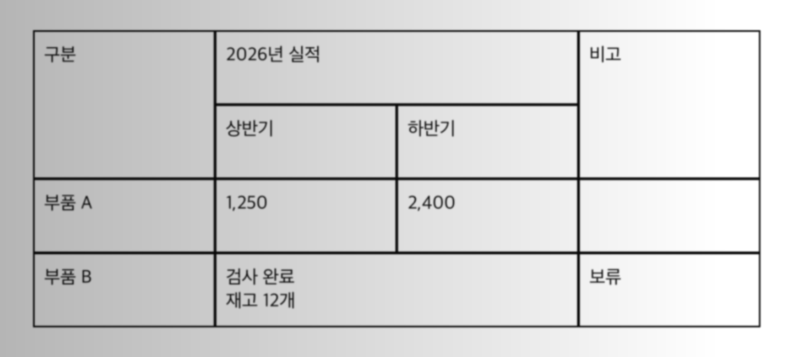

# 흐린 병합 표 수정·재검증 — 0.9.1

2026-11-07에 실패했던 **동일한 PNG**를 다시 변환했다. 수정 전에는 글자만 추출하고 표를 만들지 못했으나, 수정 후에는 4행·4열의 병합 구조와 실제 12개 셀의 값·빈칸이 모두 일치했다. 새 MD를 다시 렌더링해 행·열·rowspan·colspan·셀 값을 정답과 비교했다.

## 수정한 원인

- 고정된 밝기 기준이 그림자 배경을 잉크로 분류했다. 주변 배경과의 밝기 차이로 표선을 검출하도록 바꿨다.
- 두꺼워진 선의 가장자리들을 서로 다른 행으로 세었다. 인접 픽셀 행에서 겹치는 선 조각을 하나의 띠로 묶고 중심을 사용한다. 원래 비어 있는 병합 경계에는 선을 추가하지 않는다.
- 빈 셀에 남은 흐릿한 격자선 가장자리를 내용으로 오인했다. 셀 내부의 국소 대비로 잉크를 확인하고, 격자를 제외한 셀 잘라내기에 남은 1픽셀 테두리는 잉크 여부 판단에서만 제외한다. 내부의 작은 검은 점을 보존하는 회귀 시험도 통과했다.

원본 이미지·OCR 입력·저장 원본의 픽셀을 덮어쓰지 않는다. 표선 마스크와 잉크 여부 판단만 변경했으며 Apple Vision OCR 엔진과 기본 옵션은 그대로다. 새 OCR 의존성은 추가하지 않았다.

## 동일 조건 결과

| 표본 | 수정 전 정확한 셀 | 수정 후 정확한 셀 | 행·열·병합·빈칸 |
|---|---:|---:|---|
| 일반 격자 | 16/16 | 16/16 | 일치 |
| 병합·여러 줄 셀 | 12/12 | 12/12 | 일치 |
| 흐림·그림자가 있는 병합 표 | 0/12, 표 미검출 | 12/12 | 일치 |
| 테두리 없는 표 | 16/16 | 16/16 | 일치 |
| 합계 | 44/56 | 56/56 | 4/4 표 일치 |

- 표본 PNG SHA-256: `c57c363a76b307526a8e70209c94b99d98432ec8fff06c9bc7a3ef92aea57fb7`.
- 원본 파일 해시와 저장 원본 해시 일치, 실제 CLI 재검사로 묶음 무결성 확인.
- 기존 비교 자료 중 비표 이미지 28개에서 새 격자 오검출 0개.
- 좌우·상하 반전, 180도 회전, 75% 크기 변형 4개에서 셀 병합 구조 일치. 이 변형 검사는 구조만 확인했으며 뒤집힌 글자의 OCR 정확도 시험으로 세지 않았다.
- 로컬 회귀: **108 passed**, browser 1개 별도, 7 subtests passed. 기존 PyMuPDF/SWIG 경고 5개.
- 새 환경에 빌드 wheel을 설치한 내부 검증: **19/19**. 실제 설치 패키지로 같은 표를 변환하고 MD의 셀·병합·빈칸을 대조했다. 공식 다운로드는 설치 사전 검사를 수행하는 소스 ZIP·sdist만 제공한다.

## 시험 이미지와 실제 복원 표



아래 표는 실제 변환 MD에서 추출한 표다. 병합 셀은 Markdown 안의 HTML 표로 표현한다.

<table>
<tr>
<td rowspan="2" colspan="1">구분</td>
<td rowspan="1" colspan="2">2026년 실적</td>
<td rowspan="2" colspan="1">비고</td>
</tr>
<tr>
<td rowspan="1" colspan="1">상반기</td>
<td rowspan="1" colspan="1">하반기</td>
</tr>
<tr>
<td rowspan="1" colspan="1">부품 A</td>
<td rowspan="1" colspan="1">1,250</td>
<td rowspan="1" colspan="1">2,400</td>
<td rowspan="1" colspan="1"></td>
</tr>
<tr>
<td rowspan="1" colspan="1">부품 B</td>
<td rowspan="1" colspan="2">검사 완료<br>재고 12개</td>
<td rowspan="1" colspan="1">보류</td>
</tr>
</table>

## 재현

macOS와 필수 설치 검사를 통과한 환경에서:

```sh
sh install.sh --dev
uv run --frozen pytest -q tests/test_raster_layout.py
uv run --frozen preserve-md convert tests/fixtures/shadowed-merged-table.png --out outputs/shadowed-table-recheck
uv run --frozen preserve-md validate outputs/shadowed-table-recheck
```

정답은 [fixture JSON](../tests/fixtures/shadowed-merged-table.json), 자동 회귀 시험은 [test_raster_layout.py](../tests/test_raster_layout.py)에 있다. 원래 실패했던 표본의 바이트를 바꾸거나 정답에 맞춰 단어를 치환하지 않았다.

이 결과는 이 표본과 명시된 변형·회귀 범위의 수정 검증이다. 임의의 흐린 사진·표 전체의 정확도 인증은 아니며, 손글씨 OCR의 정확도를 개선한 변경도 아니다. 원본 대조 필요·부분 추출 상태는 유지한다.
